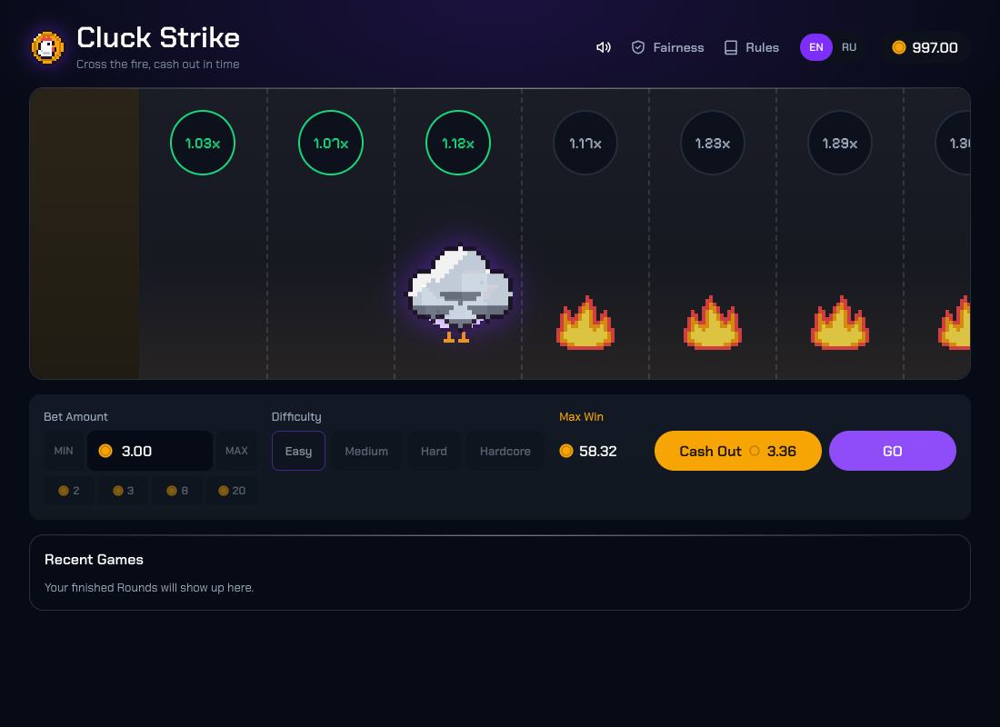
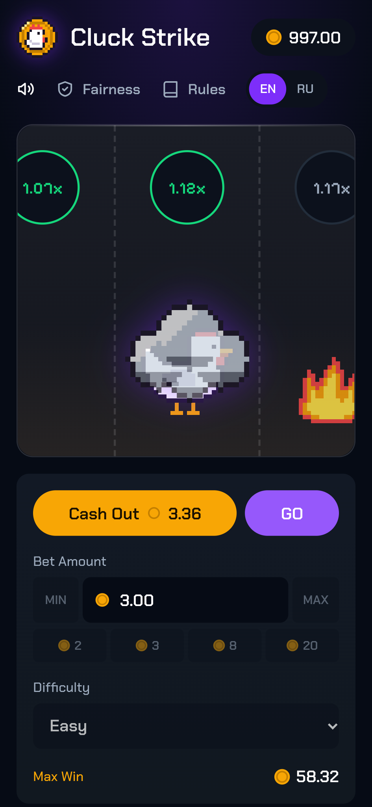

# Cluck Strike

A browser game of chance in the spirit of Chicken Road

**Play it:** https://cluck-strike.vercel.app/

## The idea

Chicken Road meets Counter-Strike. The CS chicken, a well-known easter egg of the game, has to cross a street where every Lane burns with molotov fire. On each Step it throws a smoke grenade at the next Lane. If the Smoke puts the fire out, the chicken hops into the cloud and the Multiplier grows. If the grenade flies past, the chicken lands in the flames and burns down to a skeleton, and the Bet is lost. Cash out in time, or reach the golden case at the Finish.

| Desktop                                                | Phone                                                                          |
| ------------------------------------------------------ | ------------------------------------------------------------------------------ |
|  |  |

## Decisions and why

- **The outcome is fixed when the Round starts, not by timing.** The Lane where the chicken burns comes from `HMAC-SHA256(Server Seed, Client Seed:nonce)`, and the animation only shows it. This keeps the payout math exact and makes every Round verifiable, the way games of chance on skin sites work. A skill-based "dodge the fire" version would be a different genre and could not be balanced.
- **Provably fair, and checkable without trusting the page.** The Server Seed's hash is shown before Play and the seed after the Round. The Fairness modal re-checks every Round, recomputes any Round from entered values, and gives a short JavaScript snippet that prints the same result in any browser console.
- **Multiplier tables of the reference game, RTP 98%.** Four Difficulties (24 / 22 / 20 / 15 Lanes) with the genre's tables. The chance to survive up to a Lane is `0.98 / its Multiplier`, so every Cash Out point returns 98% on average and Difficulty changes only the variance. One Round pays at most 10,000; reaching it ends the Round with an automatic Cash Out.
- **A mock server behind a backend-shaped contract.** There is no backend, so the client talks to an in-browser "server" with the calls a real one would have (start a Round, Step, Cash Out, current Round). The seed and the Round state live on its side and survive a reload, so a refresh mid-Round continues on the same Lane with the same outcome.
- **An original theme, not a copy.** CS chicken, molotov fire and smoke grenades instead of Chicken Road's characters and look; no Valve or cs2skin assets.
- **cs2skin's look.** Colours, cards, flat buttons and header links were taken from cs2skin.com's Mines, Crash and Royale pages, with violet only for primary actions.
- **8-bit art drawn in code.** Every sprite is a small text grid of characters with one shared palette, turned into a frame-by-frame sprite sheet: the chicken (idle, throw, hop), the burn down to a skeleton, the golden case bursting open, fire, Smoke and the grenade. The style stays consistent, there is nothing to license, and any pixel is a one-character fix. AI-generated frames were rejected because a character drifts from frame to frame.
- **Sounds synthesized with Web Audio.** Throw, Smoke, hop, the fire burst and scream, Cash Out and the fanfare are generated in the browser, timed to the animation, with no audio files.
- **Feature-Sliced Design with an enforced boundary.** Code is split into `app → pages → widgets → features → entities → shared`, and a test fails CI when an import goes the wrong way.

## Features

- Play, GO and Cash Out; four Difficulties; Bet presets, MIN and MAX; Max Win shown and enforced.
- Autoplay: number of Rounds, the Lane to cash out on, and Stop, which lets the current Round finish.
- Fairness modal and a proof for every Round in Recent Games (last 100 Rounds, 10 at a time).
- English and Russian, sound on/off, rules; the choices are remembered.
- Keyboard: Space for Play/GO, Enter for Cash Out; screen readers hear every Step and result.
- Phone layout: the buttons sit right under the scene; sound works in Safari and Chrome on iPhone.

## Technical details

- **Stack:** React 19, TypeScript, Vite, zustand (game state), Motion (animation), Vitest and Playwright, oxlint and Prettier. Deployed on Vercel from `main`; GitHub Actions runs lint, formatting, unit tests, the build and the e2e suite on every push.
- **Structure:** game rules, fairness math and the mock server in `src/shared`; the Round model and store in `src/entities/round`; Fairness and Autoplay in `src/features`; the scene, Bet panel, top bar and Recent Games in `src/widgets`. Pixel sprites live in `src/widgets/road/pixel`.
- **State:** a zustand store is the single place where Rounds change; the Balance, Bet, settings and Recent Games are saved to `localStorage` and validated when read back, so corrupted storage starts fresh instead of crashing.
- **Money:** amounts are integer cents; payouts are `Bet × Multiplier` rounded down to the cent and capped at Max Win.
- **Tests:**
  - 81 unit tests run through the store's public API: odds and RTP over many Rounds, fairness against RFC test vectors, persistence and reload, Autoplay, the Fairness verdict, sprites, and the layer boundaries.
  - 20 Playwright scenarios run against the production build on desktop and on a 360px phone: win and Cash Out, a forced Hit, a full run to the Finish, hotkeys, reload mid-Round, Fairness and its console code, Autoplay, settings, and the phone layout.
  - Outcomes are pinned by stubbing `crypto.getRandomValues` in the page, so the app has no test backdoor.

```bash
pnpm install
pnpm dev          # http://localhost:5173
pnpm test         # unit tests
pnpm build && pnpm test:e2e
```

## Limits

- **Fairness is a demonstration.** With no backend, the Server Seed is generated and kept in the browser, so anyone with DevTools can read a Round's outcome early. A real deployment moves the seed and the Round to a server; the contract is already shaped for it.
- **Mock funds.** The Balance is demo money, with a top-up when it runs out. The mock server trusts the client's Bet limits and Balance.
- **Max Win lowers the effective RTP** slightly for large Bets; the rules say so.
- **Synthesized sounds** are simple by design. There is no music.

## Time

The playable game took about **4–4.5 hours** of active work (time away from the laptop not counted):

| Part                                                                                                           | Time       |
| -------------------------------------------------------------------------------------------------------------- | ---------- |
| Design: rules and mechanics, research of cs2skin.com and the reference game, spec, tickets                     | ≈ 1 h      |
| Building: Round engine, Bet panel, persistence, scene animation, Fairness, Recent Games, top bar, rules, EN/RU | ≈ 1 h 30 m |
| Sound, phone layout, accessibility and hotkeys                                                                 | ≈ 1 h 10 m |
| cs2skin styling and the code structure                                                                         | ≈ 35 m     |

Most of the time went into **designing the game before writing code**: how the outcome is fixed, the odds, fairness and the theme. Second came **sound and animation timing**: every effect is synced to the throw, the hop and the burn.

After that, went into extras: the 8-bit art (≈ 45 m), the Fairness verifier and Autoplay (≈ 30 m), fixes from testing on a real iPhone, a code review with its fixes, and more tests.

The commit history spans two days because of the breaks between sessions.

## Credits

All art and sound are made in this repository: pixel sprites drawn in code and Web Audio synthesis. Fonts: Chakra Petch and Pixelify Sans from Google Fonts (SIL Open Font License).

## What could come next

- A real backend for seeds, Rounds and the Balance, so fairness protects for real.
- A live feed of other players' wins and an online counter, as on cs2skin.
- More art: a pixel background street, the chicken's reaction to a near miss, a Max Win animation.
- Autoplay stop conditions: stop on a profit or a loss limit.
- Music and per-sound volume.
- A player-history page with charts and an export of all proofs.
